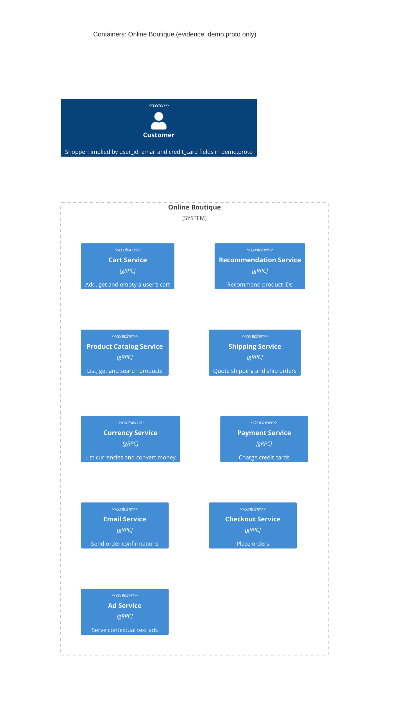

# Task 1A: Recovered C4 container architecture (Online Boutique)

## 1. Agent

- Product: Claude Code (Anthropic)
- Model: Claude Opus 5.5 (`claude-opus-5-5`)

## 2. Files read

| # | File | Why |
|---|------|-----|
| 1 | `AGENTS.md` | Repository rules |
| 2 | `prompts/1-recover-architecture.md` | Task instructions |
| 3 | `system/online-boutique/protos/demo.proto` | The only allowed evidence |

## 3. Containers table

The evidence is a single Protocol Buffers interface file. It defines **service interfaces** (gRPC `service` blocks), not deployments, languages or data stores. Each `service` is taken as one container. All are in protobuf package `hipstershop` (`demo.proto` line 17).

| Container | Technology / language | Responsibility (from RPCs) | Evidence |
|-----------|----------------------|----------------------------|----------|
| Cart Service | gRPC API (proto3). Implementation language: Not evidenced in the provided files | Add items to a user's cart, get the cart, empty it (`AddItem`, `GetCart`, `EmptyCart`) | `system/online-boutique/protos/demo.proto` lines 23-27 (`service CartService`) |
| Recommendation Service | gRPC API (proto3). Language: Not evidenced | Return recommended product IDs for a user and a list of products (`ListRecommendations`) | `demo.proto` lines 56-58 (`service RecommendationService`) |
| Product Catalog Service | gRPC API (proto3). Language: Not evidenced | List, get and search products (`ListProducts`, `GetProduct`, `SearchProducts`) | `demo.proto` lines 71-75 (`service ProductCatalogService`) |
| Shipping Service | gRPC API (proto3). Language: Not evidenced | Quote shipping cost and ship an order, returning a tracking ID (`GetQuote`, `ShipOrder`) | `demo.proto` lines 107-110 (`service ShippingService`) |
| Currency Service | gRPC API (proto3). Language: Not evidenced | List supported currencies and convert money between currencies (`GetSupportedCurrencies`, `Convert`) | `demo.proto` lines 140-143 (`service CurrencyService`) |
| Payment Service | gRPC API (proto3). Language: Not evidenced | Charge a credit card and return a transaction ID (`Charge`) | `demo.proto` lines 177-179 (`service PaymentService`) |
| Email Service | gRPC API (proto3). Language: Not evidenced | Send an order confirmation to an email address (`SendOrderConfirmation`) | `demo.proto` lines 199-201 (`service EmailService`) |
| Checkout Service | gRPC API (proto3). Language: Not evidenced | Place an order for a user (address, email, card, currency) and return an `OrderResult` (`PlaceOrder`) | `demo.proto` lines 224-226 (`service CheckoutService`) |
| Ad Service | gRPC API (proto3). Language: Not evidenced | Return text ads for a set of page context keywords (`GetAds`) | `demo.proto` lines 243-245 (`service AdService`) |

Data stores: **none evidenced.** The proto defines no database, cache or message broker.

Note: `option go_package = ".../hipstershop"` (line 19) shows Go stubs are generated from this file. It does not show which services are written in Go.

## 4. Dependencies table

| Caller -> callee | Protocol | Evidence |
|------------------|----------|----------|
| *None evidenced* | - | `demo.proto` declares what each service **offers** (server side) but never says which service **calls** which. No runtime dependency can be proven from this file alone. |

Every service in the proto is a gRPC `service` (lines 23, 56, 71, 107, 140, 177, 199, 224, 243), so any dependency **on** these services would use gRPC. Who the callers are is Not evidenced in the provided files. Likely dependencies are listed under **Gaps**.

## 5. Mermaid diagram

The diagram matches the tables exactly: 9 containers, no data stores, no external systems, and no `Rel` lines because no dependency is evidenced. The `Person` is only implied by user-facing fields (`user_id`, `email`, `credit_card` in `PlaceOrderRequest`, lines 228-235). No entry point (UI or gateway) is evidenced, so the person has no relationship.

## 6. Gaps

| Gap | What the proto suggests (not proof) | File that would settle it |
|-----|-------------------------------------|---------------------------|
| **Who calls whom** (all runtime dependencies) | **[Inferred]** `checkoutservice` likely calls Cart, Product Catalog, Currency, Shipping, Payment and Email. `PlaceOrderRequest` carries `CreditCardInfo` (also in `ChargeRequest`) and `Address` (also in `ShipOrderRequest`). `PlaceOrderResponse` returns `OrderResult` (also in `SendOrderConfirmationRequest`). Shared message types are not calls, though. | `system/online-boutique/kubernetes-manifests/checkoutservice.yaml` (`*_SERVICE_ADDR` env vars), or the checkout service source |
| **Frontend / entry point** | **[Inferred]** Something user-facing must call these services (e.g. `AdRequest.context_keys` comments mention "the current page", lines 248-249). No frontend service is in the proto. | `system/online-boutique/kubernetes-manifests/frontend.yaml` and the frontend source |
| **Customer -> system protocol** | Not evidenced (HTTP/HTTPS is only a guess) | Frontend manifest/service definition (ports, `Service` type) |
| **Cart storage** | **[Inferred]** `CartService` keeps per-user state (`GetCart` by `user_id`), so it probably uses a data store. Which one is not evidenced. | `system/online-boutique/kubernetes-manifests/cartservice.yaml` and any Redis/DB manifest |
| **Other data stores** (product catalog data, ads, currency rates) | Not evidenced. Data could be in a DB, a file or hard-coded. | Service source code or manifests for `productcatalogservice`, `adservice`, `currencyservice` |
| **Implementation language of each service** | Not evidenced (only Go stub package, line 19) | Each service's source folder or `Dockerfile` under `system/online-boutique/src/` |
| **External systems** (real payment gateway, real email provider) | Not evidenced. Payment and Email might be mocks or might call third parties. | `paymentservice` and `emailservice` source code |
| **Recommendation -> Product Catalog** | **[Inferred]** Recommendation returns product IDs and might read the catalog. | `system/online-boutique/kubernetes-manifests/recommendationservice.yaml` (`PRODUCT_CATALOG_SERVICE_ADDR`) |
| **Asynchronous messaging / brokers** | None in the proto. All RPCs are unary request/response. | Manifests (to confirm no broker is deployed) |
| **Deployment** (replicas, ports, service discovery) | Not evidenced | `system/online-boutique/kubernetes-manifests/` |
