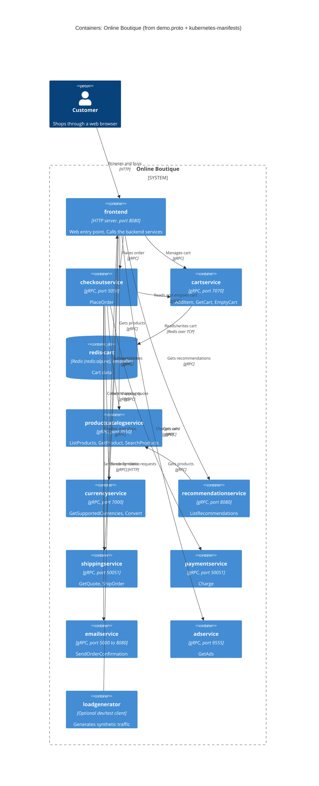

# Task 1B: Recovered C4 container architecture (Online Boutique)

## 1. Agent

- Product: Claude Code (Anthropic)
- Model: Claude Opus 5.5 (`claude-opus-5-5`)

## 2. Files read

Task and rules:

- `prompts/1-recover-architecture.md`
- `AGENTS.md`

Evidence:

- `system/online-boutique/protos/demo.proto`
- `system/online-boutique/kubernetes-manifests/kustomization.yaml`
- `system/online-boutique/kubernetes-manifests/frontend.yaml`
- `system/online-boutique/kubernetes-manifests/cartservice.yaml`
- `system/online-boutique/kubernetes-manifests/checkoutservice.yaml`
- `system/online-boutique/kubernetes-manifests/recommendationservice.yaml`
- `system/online-boutique/kubernetes-manifests/adservice.yaml`
- `system/online-boutique/kubernetes-manifests/currencyservice.yaml`
- `system/online-boutique/kubernetes-manifests/emailservice.yaml`
- `system/online-boutique/kubernetes-manifests/paymentservice.yaml`
- `system/online-boutique/kubernetes-manifests/productcatalogservice.yaml`
- `system/online-boutique/kubernetes-manifests/shippingservice.yaml`
- `system/online-boutique/kubernetes-manifests/loadgenerator.yaml`
- `system/online-boutique/kubernetes-manifests/README.md`

Notes: I could not list the folder, so I opened the files named in `kustomization.yaml` (`resources:`) plus `loadgenerator.yaml` (named in a comment there) and `README.md`. I also tried `kubernetes-manifests/redis.yaml`, which does not exist. Redis is defined inside `cartservice.yaml`.

## 3. Containers table

Language/runtime: every service manifest uses a bare image name (e.g. `image: frontend`), so the language is **Not evidenced in the provided files**. Responsibilities come from the gRPC service definitions in `demo.proto`.

| Container | Technology / language | Responsibility | Evidence |
|---|---|---|---|
| `frontend` | HTTP server on port 8080, exposed through a `LoadBalancer`. Language not evidenced | Web entry point for shoppers. Calls the backend services | `kubernetes-manifests/frontend.yaml` (Service `frontend-external` type `LoadBalancer`, port name `http`, `httpGet` probe `/_healthz`) |
| `cartservice` | gRPC server on port 7070. Language not evidenced | Add items, get the cart, empty the cart (`AddItem`, `GetCart`, `EmptyCart`) | `protos/demo.proto` (`service CartService`); `kubernetes-manifests/cartservice.yaml` (port name `grpc`, `grpc` probe) |
| `redis-cart` (data store) | Redis (`redis:alpine`) on port 6379. `emptyDir` volume at `/data` | Stores cart data for `cartservice` | `kubernetes-manifests/cartservice.yaml` (Deployment `redis-cart`, `image: redis:alpine`, `volumes: redis-data emptyDir`) |
| `productcatalogservice` | gRPC server on port 3550. Language not evidenced | List, get and search products (`ListProducts`, `GetProduct`, `SearchProducts`) | `protos/demo.proto` (`service ProductCatalogService`); `kubernetes-manifests/productcatalogservice.yaml` |
| `currencyservice` | gRPC server on port 7000. Language not evidenced | List supported currencies and convert money (`GetSupportedCurrencies`, `Convert`) | `protos/demo.proto` (`service CurrencyService`); `kubernetes-manifests/currencyservice.yaml` |
| `recommendationservice` | gRPC server on port 8080. Language not evidenced | Recommend product IDs (`ListRecommendations`) | `protos/demo.proto` (`service RecommendationService`); `kubernetes-manifests/recommendationservice.yaml` |
| `shippingservice` | gRPC server on port 50051. Language not evidenced | Quote shipping cost and ship orders (`GetQuote`, `ShipOrder`) | `protos/demo.proto` (`service ShippingService`); `kubernetes-manifests/shippingservice.yaml` |
| `checkoutservice` | gRPC server on port 5050. Language not evidenced | Place an order (`PlaceOrder`) and return an `OrderResult` | `protos/demo.proto` (`service CheckoutService`); `kubernetes-manifests/checkoutservice.yaml` |
| `paymentservice` | gRPC server on port 50051. Language not evidenced | Charge a credit card (`Charge`) and return a `transaction_id` | `protos/demo.proto` (`service PaymentService`); `kubernetes-manifests/paymentservice.yaml` |
| `emailservice` | gRPC server (Service port 5000 → container port 8080). Language not evidenced | Send order confirmations (`SendOrderConfirmation`) | `protos/demo.proto` (`service EmailService`); `kubernetes-manifests/emailservice.yaml` (Service `port: 5000`, `targetPort: 8080`) |
| `adservice` | gRPC server on port 9555. Language not evidenced | Return ads for context keywords (`GetAds`) | `protos/demo.proto` (`service AdService`); `kubernetes-manifests/adservice.yaml` |
| `loadgenerator` (optional, development/test) | Language not evidenced. Init container `busybox` checks the frontend with `wget` | Generates synthetic traffic against the frontend (`USERS=10`, `RATE=1`). Commented out of `kustomization.yaml` | `kubernetes-manifests/loadgenerator.yaml`; `kubernetes-manifests/kustomization.yaml` (line `# - loadgenerator.yaml`) |

Interaction style: every RPC in `demo.proto` is unary (no `stream` keyword), so all service-to-service calls are synchronous request/response. No message broker appears in the evidence.

## 4. Dependencies table

| Caller → callee | Protocol | Evidence (file · symbol / env var) |
|---|---|---|
| Customer → `frontend` | HTTP | `kubernetes-manifests/frontend.yaml` · Service `frontend-external` (`LoadBalancer`, port 80 `http` → 8080) |
| `loadgenerator` → `frontend` | HTTP | `kubernetes-manifests/loadgenerator.yaml` · `FRONTEND_ADDR=frontend:80`, `wget http://${FRONTEND_ADDR}` |
| `frontend` → `productcatalogservice` | gRPC | `kubernetes-manifests/frontend.yaml` · `PRODUCT_CATALOG_SERVICE_ADDR=productcatalogservice:3550` |
| `frontend` → `currencyservice` | gRPC | `kubernetes-manifests/frontend.yaml` · `CURRENCY_SERVICE_ADDR=currencyservice:7000` |
| `frontend` → `cartservice` | gRPC | `kubernetes-manifests/frontend.yaml` · `CART_SERVICE_ADDR=cartservice:7070` |
| `frontend` → `recommendationservice` | gRPC | `kubernetes-manifests/frontend.yaml` · `RECOMMENDATION_SERVICE_ADDR=recommendationservice:8080` |
| `frontend` → `shippingservice` | gRPC | `kubernetes-manifests/frontend.yaml` · `SHIPPING_SERVICE_ADDR=shippingservice:50051` |
| `frontend` → `checkoutservice` | gRPC | `kubernetes-manifests/frontend.yaml` · `CHECKOUT_SERVICE_ADDR=checkoutservice:5050` |
| `frontend` → `adservice` | gRPC | `kubernetes-manifests/frontend.yaml` · `AD_SERVICE_ADDR=adservice:9555` |
| `checkoutservice` → `productcatalogservice` | gRPC | `kubernetes-manifests/checkoutservice.yaml` · `PRODUCT_CATALOG_SERVICE_ADDR=productcatalogservice:3550` |
| `checkoutservice` → `shippingservice` | gRPC | `kubernetes-manifests/checkoutservice.yaml` · `SHIPPING_SERVICE_ADDR=shippingservice:50051` |
| `checkoutservice` → `paymentservice` | gRPC | `kubernetes-manifests/checkoutservice.yaml` · `PAYMENT_SERVICE_ADDR=paymentservice:50051` |
| `checkoutservice` → `emailservice` | gRPC | `kubernetes-manifests/checkoutservice.yaml` · `EMAIL_SERVICE_ADDR=emailservice:5000` |
| `checkoutservice` → `currencyservice` | gRPC | `kubernetes-manifests/checkoutservice.yaml` · `CURRENCY_SERVICE_ADDR=currencyservice:7000` |
| `checkoutservice` → `cartservice` | gRPC | `kubernetes-manifests/checkoutservice.yaml` · `CART_SERVICE_ADDR=cartservice:7070` |
| `recommendationservice` → `productcatalogservice` | gRPC | `kubernetes-manifests/recommendationservice.yaml` · `PRODUCT_CATALOG_SERVICE_ADDR=productcatalogservice:3550` |
| `cartservice` → `redis-cart` | Redis over TCP | `kubernetes-manifests/cartservice.yaml` · `REDIS_ADDR=redis-cart:6379` (Service port name `tcp-redis`) |

How the protocol was determined: each callee's Kubernetes Service names its port `grpc` and uses `grpc` readiness/liveness probes, and each callee has a matching `service …` in `demo.proto`. The env vars show *that* a caller is configured to reach a callee. They do not show *which* RPCs it calls.

## 5. Mermaid diagram

Relationship labels such as "Charges card" summarize the callee's RPCs in `demo.proto`. Which RPCs each caller actually invokes is **[Inferred]**.

## 6. Gaps

| Gap | Why it is open | File that would settle it |
|---|---|---|
| Implementation language/runtime of every service | The manifests use bare image names (`image: frontend`, …). The proto is language-neutral | Each service's source folder or `Dockerfile` (e.g. `system/online-boutique/src/<service>/Dockerfile`) |
| `shoppingassistantservice` | `frontend.yaml` sets `SHOPPING_ASSISTANT_SERVICE_ADDR=shoppingassistantservice:80`, but no manifest that I read deploys it, and `kustomization.yaml` comments out `../kustomize/components/shopping-assistant`. Left out of the diagram | `system/online-boutique/kustomize/components/shopping-assistant/` and the frontend source |
| Which RPCs each caller uses, and call order in checkout | Env vars give addresses only | Caller source code (e.g. `src/checkoutservice/`, `src/frontend/`) |
| Whether `paymentservice` calls a real payment provider | No external address or credentials in its manifest. Not evidenced in the provided files | `src/paymentservice/` source |
| Whether `emailservice` sends real email (SMTP or a provider) | No SMTP or provider config in its manifest. Not evidenced in the provided files | `src/emailservice/` source |
| Where `productcatalogservice` gets its product data | No database env var. Not evidenced in the provided files | `src/productcatalogservice/` source |
| Where `currencyservice` gets exchange rates | No external address. Not evidenced in the provided files | `src/currencyservice/` source |
| How `adservice` and `recommendationservice` pick results | Not evidenced in the provided files | Their source folders |
| Durability of cart data | `redis-cart` uses an `emptyDir` volume, so the data is lost when the pod is rescheduled **[Inferred from Kubernetes semantics]**. Optional alternatives (`memorystore`, `alloydb`, `spanner` components) are commented out in `kustomization.yaml` | `system/online-boutique/kustomize/components/{memorystore,alloydb,spanner}/` |
| Optional add-ons (network policies, Google Cloud operations, packaging service via `PACKAGING_SERVICE_URL`) | All are commented out, so none appear in the diagram | `system/online-boutique/kustomize/components/*` |
| Other files in `kubernetes-manifests/` | I could not list the folder. I read only the files named in `kustomization.yaml`, `loadgenerator.yaml` and `README.md` | A directory listing of `system/online-boutique/kubernetes-manifests/` |
| Ingress / TLS for the customer connection | Only a plain HTTP `LoadBalancer` on port 80 is shown. HTTPS is not evidenced in the provided files | `system/online-boutique/release/` or any ingress/istio manifests |
